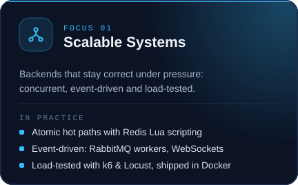
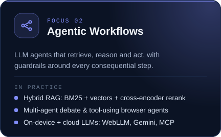
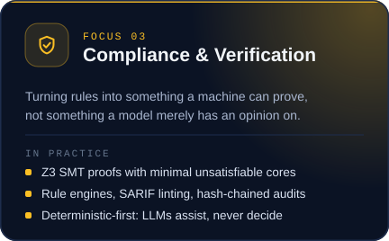
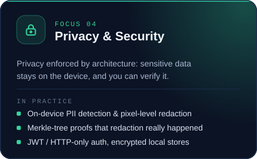
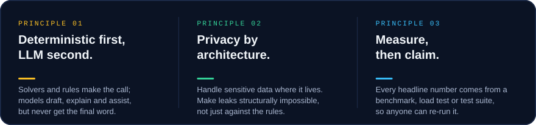
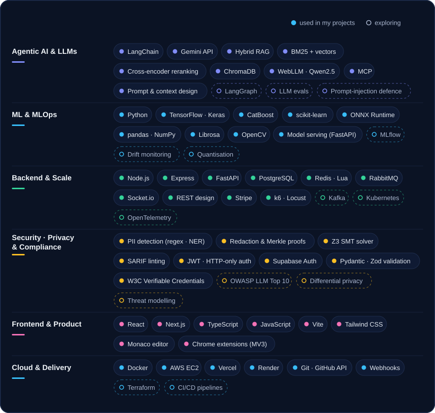

 

**I treat AI as an engineering discipline**: something to be architected, load-tested, verified and secured, not just prompted.
 
I build agentic workflows that retrieve and act, backends that hold up under concurrent load,
 
and systems where **compliance and privacy are enforced by design**.

 

| | |
|:--|:--|
| 🔭 **Exploring** | Agent guardrails · LLM evaluation · on-device models · AI security |
| 🛠️ **Building** | Production-minded AI systems, from the model to the API to the interface |
| 🎯 **Looking for** | Internships and opportunities in AI/ML, agentic systems and backend engineering |
| 🏁 **Hackathons** | Smart India Hackathon 2026, including an ISRO problem statement |

 

<table>
<tr>
<td width="50%" valign="top"></td>
<td width="50%" valign="top"></td>
</tr>
<tr>
<td width="50%" valign="top"></td>
<td width="50%" valign="top"></td>
</tr>
</table>

 

 

 

 

&nbsp;

&nbsp;

 

&nbsp;

 

