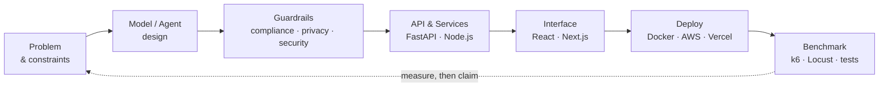

  

---

## 👋 About

I treat AI as an **engineering discipline**: something to be architected, load-tested, verified and secured, not just prompted.

My work sits where **machine learning meets real systems**. I build agentic workflows that retrieve and act, backends that stay correct under concurrent load, and products where **compliance and privacy are enforced by architecture** rather than promised in a policy document.

I'm a student developer looking for an **internship** where I can contribute to production AI, agentic systems or backend infrastructure, and keep learning from strong engineers.

---

## 🎯 What I Do

| | Focus area | What it means in practice |
|:--:|:--|:--|
| ⚙️ | **Scalable Systems** | Concurrent, event-driven backends with atomic hot paths (Redis + Lua), async workers (RabbitMQ), real-time delivery (WebSockets), validated under load with k6 and Locust, shipped in Docker. |
| 🤖 | **Agentic Workflows** | LLM agents that retrieve, reason and act: hybrid RAG (BM25 + vector search with cross-encoder reranking), multi-agent debate, tool-using browser agents, on-device and cloud models. |
| 🧾 | **AI Compliance & Verification** | Turning rules into something a machine can prove: formal verification with the Z3 SMT solver, rule engines and SARIF linting, audit trails, and a deterministic-first design where LLMs assist but never decide. |
| 🔐 | **Privacy & Security** | Privacy enforced by architecture: on-device PII detection and redaction, cryptographic (Merkle-tree) proof of redaction, encrypted local storage, hardened authentication and strict input validation. |
| 📈 | **ML in Production** | Taking models from notebook to containerised API: tabular ML, deep learning for audio, threshold tuning for real-world trade-offs, and serving with FastAPI. |

---

## 🧭 How I Build

**Principles**

- **Deterministic first, LLM second.** Rules, solvers and proofs make the decision; models draft, explain and assist.
- **Privacy by architecture.** Handle sensitive data where it lives, so leaks are structurally impossible rather than merely discouraged.
- **Measure, then claim.** Every headline number should come from a benchmark, a load test or a test suite that anyone can re-run.

---

## 🧰 Skills & Stack

**Agentic AI & LLMs**
 

**Machine Learning & MLOps**
 

**Backend & Scalability**
 

**Security, Privacy & Compliance**
 

**Frontend**
 

**Cloud & Delivery**
 

**Currently exploring**
 

---

## 💼 Open to Opportunities

I'm actively looking for **internships and early-career roles** in:

- **AI / ML Engineering**: model development, evaluation and serving
- **LLM & Agent Systems**: RAG, tool-using agents, guardrails
- **Backend / Platform Engineering**: scalable, event-driven services
- **AI Security, Privacy & Compliance**: trustworthy and verifiable AI

**What I bring:** I ship end-to-end (model → API → UI → deploy), I think in guarantees (atomicity, proofs, privacy), and I back claims with benchmarks.

---

## 📊 GitHub Activity

---

## 🤝 Let's Connect

Open to conversations about applied AI, agentic systems and secure, scalable backends.

