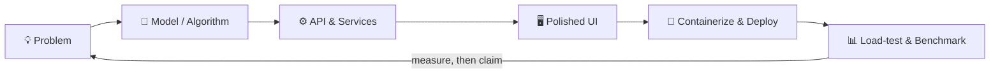

<!-- ═══════════════════════════════════════════════════════════════ -->
<!--   PROFILE README  ·  save as  Bhavesh-girase/README.md          -->
<!--   (repo name must match your username: Bhavesh-girase/Bhavesh-girase) -->
<!-- ═══════════════════════════════════════════════════════════════ -->

 

---

## 👨‍💻 About Me

I build **end-to-end intelligent systems**: from training a model to wrapping it in an API, shipping a polished UI, and load-testing the result. My projects share one habit: **claims backed by numbers**: benchmarks, load tests, and reproducible results rather than buzzwords.

| | |
|---|---|
| 🔭 **Currently exploring** | Repository-aware RAG, on-device ML, privacy-preserving AI agents |
| ⚙️ **Strong suit** | Taking ML from notebook → containerized API → deployed web app |
| 🏁 **Hackathons** | Smart India Hackathon 2026 (two problem statements, incl. ISRO PS26171) |
| 🧪 **Engineering style** | Atomic operations, formal verification, honest documentation |
| 🤝 **Open to** | Internships, collaborations, hackathon teams, open-source |

---

## 🏆 Featured Projects

### 🧾 [SpecSure](https://github.com/Bhavesh-girase/SpecsSure): *Tender Intelligence & Standards Compliance*
> **"Compile tenders like code. Prove compliance like math."** · Smart India Hackathon 2026 · PS SIH26108 · Team CodeNova

Treats government procurement tenders as **source code**: parses them into an AST, lints them with **38 rules** (SARIF 2.1.0 export), and uses the **Z3 SMT solver** to *prove* contradictory clauses with minimal unsatisfiable cores. It resolves Indian Standards as of the tender date and tracks corrigenda git-style. The LLM is optional and never decides, so every finding comes from the parser, rule engine, solver, or knowledge base.

`29,875 standards in KB` · `~15 ms mean compile` · `87.5% top-1 / 100% top-3 retrieval` · `60+ API endpoints` · `50 passing tests`
**Stack:** Python · Next.js · Z3 · Docker · MCP

---

### 🛡️ [Privacy Vision Agent](https://github.com/Bhavesh-girase/Privacy-Vision-Agent): *On-Device Visual Perception for Private Browser Automation*
> **"The AI never sees your data. It doesn't need to."** · SIH 2026 · ISRO · PS26171

A Manifest V3 Chrome extension that lets vision-language models navigate the web while PII is detected and redacted **entirely in your browser**. It combines regex with Luhn/Verhoeff checksums, ONNX NER, and YuNet face detection. A **Merkle-tree cryptographic proof** makes each redaction independently verifiable, and a 4-position **Privacy Dial** lets you choose how much to share.

`100% F1 on sensitive-data detection` · `38 PII fixtures · 14 countries · 0 false positives` · `52/52 hybrid-debate tests`
**Stack:** JavaScript · ONNX Runtime (WASM) · WebLLM (Qwen2.5) · Express · Chrome MV3

---

### 🤖 [AI PR Reviewer](https://github.com/Bhavesh-girase/ai-pr-reviewer) · [🌐 Live](https://aiprreviewer.vercel.app)
> *Repository-aware AI code reviews for GitHub Pull Requests*

A multi-tenant review platform that goes beyond the diff. **Hybrid RAG** (BM25 + vector search) feeds a **cross-encoder reranker** (`ms-marco-MiniLM-L-6-v2`), and **Gemini** generates the review. It includes GitHub integration, webhook-driven incremental indexing, a Monaco diff workspace, and review analytics.
**Stack:** React · TypeScript · Vite · FastAPI · LangChain · ChromaDB · Supabase · Docker · AWS EC2 · Vercel

---

### ⚡ [BidRush](https://github.com/Bhavesh-girase/BidRush): *Real-Time Auction Platform with Zero Race Conditions*

Redis **Lua scripts** make bid validation atomic. **RabbitMQ** offloads email and DB sync, and **Socket.io** pushes live updates. It also has a Stripe wallet and payments flow, an admin dashboard, and cron-driven auction lifecycles.

> 🎯 **k6 "Sniper" test: 500 users, same auction, same millisecond → 1 winner, 499 correctly rejected, 0 deadlocks, 0 inconsistencies, avg < 5 ms.**

**Stack:** React 19 · Node.js · PostgreSQL · Redis · RabbitMQ · Socket.io · Stripe · Cloudinary

---

## 🧠 Machine Learning & MLOps

| Project | What it does | Highlights | Links |
|:--|:--|:--|:--:|
| 🛡️ **fraud-mlops-api** | Real-time fraud detection inference service | CatBoost · **ROC-AUC ≈ 0.977** · precision 0.93 / recall 0.81 · tuned threshold 0.25 · FastAPI + Docker · Locust load-tested (~156 ms avg, ~31.8 req/s) | [Repo](https://github.com/Bhavesh-girase/fraud-mlops-api) |
| 🎧 **Speech Emotion Recognition** | Detects emotion from uploaded or live-mic audio | CNN + LSTM · trained on RAVDESS, CREMA-D, IEMOCAP · majority-vote utterance prediction · timeline & distribution views | [Backend](https://github.com/Bhavesh-girase/ser-backend) · [Frontend](https://github.com/Bhavesh-girase/ser-frontend) · [🌐 Live](https://ser-frontend-gamma.vercel.app) |
| ☀️ **SUNWISE** | Weekly solar AC-power & DC-current forecasting | Live geolocation + map input · prediction graphs · CSV/PDF export · green-impact estimate | [App](https://github.com/Bhavesh-girase/ML-HACKATHON-) · [🌐 Live](https://ml-hackathon-olive.vercel.app) · [Model](https://github.com/Bhavesh-girase/-SUNWISE-ML-MODEL) |

---

## 💬 More Builds

- 💬 **[Real-Time-Chat-App](https://github.com/Bhavesh-girase/Real-Time-Chat-App)**: a real-time chat application · [🌐 Live](https://chat-backend-eight-vert.vercel.app)
- 🔍 **[pr-review-test](https://github.com/Bhavesh-girase/pr-review-test)**: a sandbox for testing automated PR review

---

## 🧰 Tech Arsenal

| Domain | Tools |
|:--|:--|
| **Languages** |    |
| **ML / AI** |        |
| **Frontend** |     |
| **Backend** |     |
| **Data & Infra** |        |
| **Testing & Perf** |   |

---

## 🏗️ How I Build

**Principles I follow**
- 📏 **Measure before you claim**: every headline number in my repos comes from a benchmark, a load test, or a test suite.
- 🔒 **Correctness by construction**: atomic Lua scripts, SMT proofs, and cryptographic redaction proofs instead of "trust me".
- 🔁 **Reproducible by default**: Docker, documented quick-starts, and benchmark scripts anyone can re-run.

---

## 📊 GitHub Stats

---

## 🤝 Let's Connect

*Open to collaborations on applied AI, real-time systems, and hackathon teams.*

 

> *"Compile it, prove it, benchmark it, ship it."*

